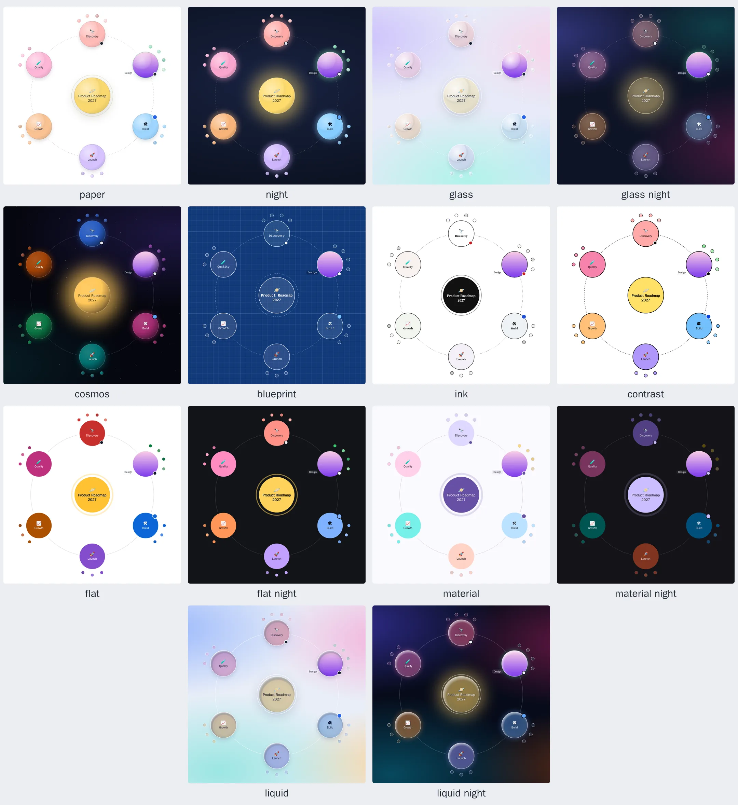

# Orbit

Mind maps written in markdown and explored like a solar system.


**[Website](https://orbit.hyuchia.com)** · [Playground](https://orbit.hyuchia.com/playground) · [Guide](docs/guide.md) · [Map format](docs/format.md) · [Recipes](docs/recipes.md) · [Theming](docs/theming.md) · [Extending](docs/extending.md) · [Editing](docs/editing.md) · [Map tools for AI](docs/map-tools.md) · [Maps from other apps](docs/import-export.md) · [Pictures and videos](docs/media.md) · [Languages](docs/languages.md) · [Accessibility](docs/accessibility.md) · [Coding agents](docs/agents.md) · [API reference](docs/api/README.md)

- Real-markdown authoring: headers and bullet lists nest the tree.
- YAML alternative for app-generated maps.
- Explorable: zoom into a node to enter it and out to leave, flick the orbit to spin it, pan and zoom the overview. Every move is animated so you never lose your place.
- Readable at any size: labels stay crisp, sized for reading and in high contrast.
- Fourteen themes, from pastel paper and a field of stars to flat, Material and liquid glass, each restylable with CSS custom properties, and Material themes built from any color.
- First-class pictures, videos, embeds and multi-line notes per node: pictures and videos open over the whole window, to zoom into and to play, and the rest in a built-in detail sheet, unless you handle `onAction` yourself.
- Built on the map: a + in the orbit adds ideas, typed right inside their planet, and nodes can be renamed, dragged and saved back as markdown.
- Ready for AI: tools any model calls to read a map and change it, for Anthropic, OpenAI, Gemini, MCP and the providers that follow OpenAI's API, with every change animated on the map.
- Keyboard and screen-reader friendly: one tab stop, arrow-key navigation, a list view of the whole map, and announcements as you move, in English, Spanish or any language you add.
- Framework-agnostic core with no dependencies; React wrapper at `@restless-dreams/orbit/react`; `marked` extension at `@restless-dreams/orbit/marked`.
- Made for coding agents too: the docs in one file (`llms-full.txt`), an agent skill, validation as JSON, and problems reported with the fix.

## Install

```bash
npm install @restless-dreams/orbit
```

React and marked are optional peers, needed only for their integrations: `npm install react react-dom` for `@restless-dreams/orbit/react`, and `npm install marked` for `@restless-dreams/orbit/marked`.

## Quick start

```ts
import { createOrbitMap } from '@restless-dreams/orbit';

const map = createOrbitMap(document.getElementById('map')!, `# 🚀 Project

## Research
## Build
## Launch`);

map.on('focus-change', ({ node }) => console.log('Now looking at', node.text));
```

The map fills its container, so give the container a size.

**React:**

```tsx
import { OrbitMindMap } from '@restless-dreams/orbit/react';

export const ProjectMap = ({ markdown }: { markdown: string }) => {
  return (
    <div style={{ height: 480 }}>
      <OrbitMindMap source={markdown} onNodeClick={(node) => console.log(node.text)} />
    </div>
  );
};
```

**Without a build step,** with the `<orbit-map>` element:

```html
<script type="module">
  import { defineOrbitMapElement } from 'https://cdn.jsdelivr.net/npm/@restless-dreams/orbit/+esm';
  defineOrbitMapElement();
</script>

<orbit-map height="420">
  # 🚀 Project

  ## Research <!-- orbit status: active -->
  ## Build
</orbit-map>
```

**In a markdown pipeline,** with marked:

```ts
import { Marked } from 'marked';
import { orbitMarked, hydrateOrbitBlocks } from '@restless-dreams/orbit/marked';

const markdown = new Marked(orbitMarked());
container.innerHTML = await markdown.parse(article); // orbit fences become map placeholders
hydrateOrbitBlocks(container);                         // turns them into live maps
```

**Without a browser,** `renderToSVGString(markdown, { width: 1200, height: 800 })` draws a standalone SVG, for static sites, emails and print.

**On paper,** `renderPrintLayout(element, markdown)` lays a map out for print or PDF: the map as a picture, then every idea with its note. Maps shared as web pages print that way.

[The guide](docs/guide.md) covers every option, event and method, and [Recipes](docs/recipes.md) shows Orbit in Vue, Svelte, Astro, Next.js and static sites.

## Write a map

Every heading and every list item is a node, the text under it is its note, and `<!-- orbit … -->` comments set attributes:

```markdown
---
title: Product roadmap
theme: night
---
# 🚀 Product roadmap

## Research <!-- orbit status: done -->
Six weeks of interviews before we commit to scope.
- [x] User interviews
- Competitor teardown #market

## Build <!-- orbit status: active -->
### Frontend
- [/] App shell
- Offline sync
### Backend

## Launch

```

Maps can be YAML too, for the ones programs write. [The map format](docs/format.md) has every rule, attribute, option and diagnostic, and `npx @restless-dreams/orbit example` prints a map with the main features.

## Themes



Pick one with the `theme` option, the `theme` attribute or `theme:` in the frontmatter. Every color, size and finish is a CSS custom property your page can set, and `materialTheme('#0B57D0')` builds a Material theme from any color. See [Theming](docs/theming.md).

## Command line

```bash
npx @restless-dreams/orbit validate my-map.md                  # every problem as my-map.md:line: severity: message [code]
npx @restless-dreams/orbit validate --json my-map.md           # the same as JSON, for scripts and coding agents
npx @restless-dreams/orbit validate --tree my-map.md           # the map as Orbit reads it, with each node's id
npx @restless-dreams/orbit render my-map.md --out my-map.svg   # draw a map to SVG (--view all for the whole map)
npx @restless-dreams/orbit export --html my-map.md --out my-map.html  # one web page to explore, present or print the map, offline
npx @restless-dreams/orbit convert --to yaml my-map.md         # markdown ↔ YAML (either direction)
npx @restless-dreams/orbit convert --to md Plan.xmind --out plan.md  # a map from XMind, FreeMind, Freeplane or OPML (--to opml writes OPML)
npx @restless-dreams/orbit example > my-map.md                 # a map with the main features (--yaml for YAML)
```

## AI in your app

`createMapTools(map)` gives a language model tools to read the map and change it, in the shape your provider's API takes. Its changes animate on the map, and a call it gets wrong changes nothing and says what to send instead:

```ts
import { createMapTools } from '@restless-dreams/orbit';

const tools = createMapTools(map);   // a map on screen, or a document on a server
tools.for('anthropic');              // the tools for the model: also 'openai', 'openai-chat' and 'gemini'
tools.run('add_nodes', { parent_id: 'research', outline: '- Interviews\n- Survey' });   // each call it makes: { ok, text, changed }
```

[Map tools for AI](docs/map-tools.md) has the whole loop for each provider.

## Coding agents

Point your agent at `node_modules/@restless-dreams/orbit/llms-full.txt`, the docs in one file, or install the skill for Codex, Claude Code, Kimi Code and other agents with `npx skills add restless-dreams/orbit`. [Coding agents](docs/agents.md) has the details.

## Browsers

Orbit is made for current browsers, and draws in older ones down to Chromium 99, which some phones' WebViews still run, with plainer versions of the few effects that need newer CSS ([which ones](docs/guide.md#browsers)).

## Contributing

With [Bun](https://bun.sh) installed, `bun install`, then `bun run verify` runs the linter, the type checks, the tests and the build. [CONTRIBUTING.md](CONTRIBUTING.md) has the rest, [RELEASE.md](RELEASE.md) how releases are made, and [docs/architecture.md](docs/architecture.md) how Orbit is put together.

## License

[MIT](LICENSE)
